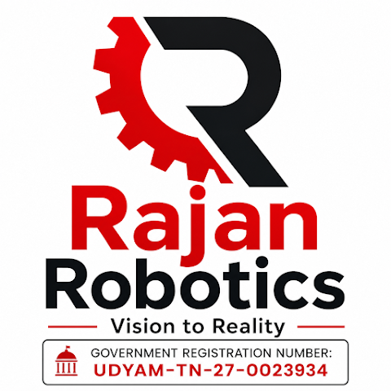

<p align="center">
  
</p>

# 🤖 Rajan Robotics — Arduino OLED Display Animation

**Vision to Reality** | *Practical Learning in Embedded Systems & Robotics*

An interactive Arduino sketch designed for a **0.91-inch (128×32) I2C OLED display (SSD1306)**. Built for our Instagram Reel showcase, this project demonstrates custom bitmap rendering, smooth frame timing, and multi-stage UI transitions on a microcontroller.

---

## 🎬 Animation Sequence Overview

1. **3-Second Countdown (`runCountdown`):** Large centered digits (`3` → `1`) framed by a border and a real-time shrinking progress bar.
2. **Expressive Robot Eyes (`runFiveSecAnimation`):** Animated robotic eyes that open, blink, and glance left and right.
3. **Sensor / LiDAR Sweep:** A dynamic fan scan under the **"PRACTICAL LEARNING"** header.
4. **Rajan Robotics Brand Reveal (`showRajanRoboticsLogo`):** Displays the custom **32×32 Gear + 'R' bitmap emblem** alongside **RAJAN ROBOTICS** and the **Vision2Reality** tagline, punctuated by an inverse display flash.

---

## 🛠️ Hardware Requirements

* **Microcontroller:** Arduino Uno, Arduino Nano, or compatible ATmega328P board
* **Display:** 0.91" `128×32` Monochrome I2C OLED Module (`SSD1306` driver)
* **Connections:** 4× Female-to-Male Jumper Wires & Breadboard

---

## 🔌 Circuit Wiring Diagram

<p align="center">
  
</p>

| OLED Pin | Arduino Uno / Nano Pin | Description |
| :--- | :--- | :--- |
| **GND** | **GND** | Common Ground |
| **VCC** | **5V** | Power Supply (`3.3V`–`5V` tolerant) |
| **SCL** | **A5** (or dedicated `SCL`) | I2C Serial Clock |
| **SDA** | **A4** (or dedicated `SDA`) | I2C Serial Data |

---

## 📚 Required Arduino Libraries

Before compiling, install the following libraries via **Arduino IDE → Sketch → Include Library → Manage Libraries...**:

1. **Adafruit SSD1306** *(by Adafruit)*
2. **Adafruit GFX Library** *(by Adafruit)*

---

## 🚀 Quick Start & Configuration

1. Download `RR_Arduino_OLED_Logo_Animation.ino` from this repository and open it in the **Arduino IDE**.
2. Verify the I2C address and screen dimensions at the top of the sketch:
   ```cpp
   #define SCREEN_WIDTH 128
   #define SCREEN_HEIGHT 32    // Change to 64 if using a 0.96" 128x64 OLED
   #define SCREEN_ADDRESS 0x3C // Change to 0x3D if your screen remains blank
   ```
3. Select your **Board** and **COM Port** under **Tools**, then click **Upload**.

---

## 🌐 Connect with Rajan Robotics

* **GitHub:** [://github.com]((https://://github.com](https://github.com/rajanrobotics05-RR))
* **Motto:** *Vision to Reality — Practical Learning*

---
*Created by Rajan Robotics (UDYAM-TN-27-0023934). Feel free to fork, modify, and use this code in your own robotics projects!*
